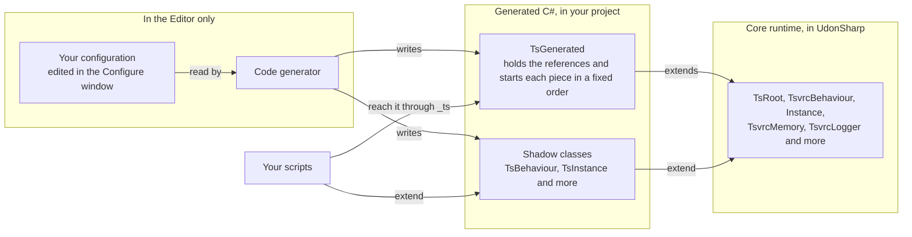

# TsVRC Core

UdonSharp framework for VRChat worlds: structured initialization, dependency wiring, and editor
codegen.

> [!WARNING]
> Core is a proof of concept, written partly by hand and partly with AI coding tools. I'm reviewing
> it and adding tests so it works correctly. The tools that don't need the framework move to
> [Udon Tools Kit](https://github.com/tsvrc/udon-tools-kit) and
> [Udon Test Kit](https://github.com/tsvrc/udon-test-kit), which are reviewed, fully tested and
> ready to use, and the plan is to build Core on top of Udon Tools Kit. Until Core gets there, test
> what your world relies on before you publish it, and if something breaks,
> [open an issue](https://github.com/tsvrc/tsvrc-core/issues) and I'll take a look.

*Core is a [TsVRC](https://tsvrc.com) project by [Antony Seas](https://github.com/ToniSeas). It
isn't affiliated with, endorsed by, or sponsored by VRChat Inc.*

## How it works

In the Editor, a code generator reads your configuration, writes C# into your project and sets the
references in your scene. The generator itself never reaches the world. In the world, your scripts
extend the generated classes and reach what Core wired for them through `_ts`. Is this
overengineered? Maybe, but I like it.

## What's included

Core generates the code for each of these from your configuration:

| Piece | What it does |
|---|---|
| Constructs | Register a behaviour once, and Core initializes it in a fixed order. |
| Globals | Point at a scene object once, and reach it from any behaviour as a `_ts` member. |
| Memory | A shared key-value store with ephemeral, persistent and synced tiers. |
| Factories | Spawn a prefab on demand with a generated `_ts.Create...` call. |
| Pools | Pre-instantiate and wire the instances a networked prefab needs, since Udon behaviours on objects instantiated while the world runs don't sync. |
| Instance | One behaviour that stands for the running world instance, found and wired for you. |

## Install

Requires Unity 2022.3 and the VRChat Worlds SDK 3.10.

Install **TsVRC Core** (`com.tsvrc.core`) as
[Install a TsVRC package](https://tsvrc.com/docs/install-a-package) describes. The `.unitypackage`
is on the [releases page](https://github.com/tsvrc/tsvrc-core/releases). Then check what it added:
[Add TsVRC Core to your project](https://tsvrc.com/docs/core/add-to-your-project).

## Documentation

The guides and the reference are at [tsvrc.com/docs/core](https://tsvrc.com/docs/core/intro).
Start with [Build your first behaviour](https://tsvrc.com/docs/core/first-behaviour), and read
[How Core fits together](https://tsvrc.com/docs/core/core-concepts/how-it-fits-together) for each
half in detail.

## Contributing

Bug reports, fixes and new features are welcome. [CONTRIBUTING.md](CONTRIBUTING.md) covers the
setup, running the tests and opening a pull request. Ask questions in
[GitHub Discussions](https://github.com/orgs/tsvrc/discussions), and report a security issue
privately, as [SECURITY.md](SECURITY.md) describes. The
[Code of Conduct](https://github.com/tsvrc/.github/blob/main/CODE_OF_CONDUCT.md) applies to everyone
taking part, and [GOVERNANCE.md](https://github.com/tsvrc/.github/blob/main/GOVERNANCE.md) covers
how decisions get made.

## License

Apache-2.0, see [LICENSE.md](LICENSE.md) and [NOTICE](NOTICE). The TsVRC name and logo are covered
separately, in [TRADEMARK.md](https://github.com/tsvrc/.github/blob/main/TRADEMARK.md).
