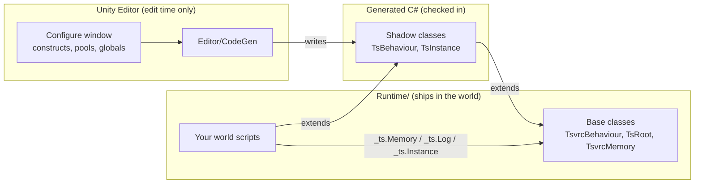

# TsVRC Core

[](https://github.com/tsvrc/tsvrc-core/releases)
[](https://github.com/tsvrc/tsvrc-core/commits/main)
[](LICENSE.md)

> [!WARNING]
> Core is an experiment, and AI coding tools generated part of its features. It isn't fully vibe
> coded, but AI had a large share in writing it. Test the behaviour your world relies on before you
> publish it. For a project that's ready to use, consider
> [Udon Test Kit](https://github.com/tsvrc/udon-test-kit).

Core is an open-source framework for building VRChat worlds with UdonSharp: structured
initialization, dependency wiring, and an editor tool that generates the code for both, on top of
the VRChat Worlds SDK.

Most frameworks like this resolve dependencies at runtime, through reflection or a
dependency-injection container. Core resolves them once, at edit time: an editor pass reads your
project configuration and writes plain C# with the references already in place. Nothing gets
looked up while the world is running.

Docs: [tsvrc.com/docs/core](https://tsvrc.com/docs/core/intro).

*Core is a [TsVRC](https://tsvrc.com) project. It isn't affiliated with, endorsed by, or sponsored
by VRChat Inc.*

## Quick look

```csharp
using Tsvrc.Core.Generated;

public class HelloWorld : TsBehaviour
{
    protected override void TsStart()
    {
        LogInfo("HelloWorld constructed.");
    }
}
```

Attach this to a GameObject, register it as a construct in **Tsvrc > Configure**, and Core calls
`TsStart` on it once at world startup. Full walkthrough:
[Build your first behaviour](https://tsvrc.com/docs/core/first-behaviour).

## How it fits together

Core splits into two halves: an editor pass that runs while you build, and plain UdonSharp that
runs for players. Your scripts extend a generated shadow class instead of the runtime classes, so
they get a typed reference to your project rather than a generic one.



Full explanation:
[How Core fits together](https://tsvrc.com/docs/core/core-concepts/how-it-fits-together).

*Is this overengineered? Maybe, but I like it.*

## What's included

Six generated pieces cover most of what a world needs:

- Constructs: register a behaviour once, and Core initializes it in a fixed order.
- Globals: point at a scene object once and reach it from any behaviour by name.
- Memory: a shared key-value store with ephemeral, persistent and synced tiers.
- Factories: spawn a prefab on demand with a generated `_ts.Create...` call.
- Pools: pre-instantiate and wire the instances a networked prefab needs, since VRChat can't sync
  an object created while the world is running.
- Instance: one behaviour that stands for the running world instance, found and wired
  automatically.

Details for each: [tsvrc.com/core](https://tsvrc.com/core).

## Install

Requires Unity 2022.3 and the VRChat Worlds SDK 3.10.

Install **TsVRC Core** (`com.tsvrc.core`) as described in
[Install a TsVRC package](https://tsvrc.com/docs/install-a-package); the `.unitypackage` is on the
[releases page](https://github.com/tsvrc/tsvrc-core/releases). Then check what it added:
[Add TsVRC Core to your project](https://tsvrc.com/docs/core/add-to-your-project).

## Contributing

Bug reports, fixes and new features are welcome. Core is pre-1.0, so its API can still change.
[CONTRIBUTING.md](CONTRIBUTING.md) covers setting up a project to develop Core in, running its
tests, and opening a pull request. Ask questions in
[GitHub Discussions](https://github.com/orgs/tsvrc/discussions) rather than in an issue.

Found a security issue? Follow [SECURITY.md](SECURITY.md) instead of opening a public issue.
Community conduct is covered by the
[org-wide Code of Conduct](https://github.com/tsvrc/.github/blob/main/CODE_OF_CONDUCT.md), and
[GOVERNANCE.md](https://github.com/tsvrc/.github/blob/main/GOVERNANCE.md) covers how decisions get
made.

## License

Apache-2.0, see [LICENSE.md](LICENSE.md) and [NOTICE](NOTICE). The TsVRC name and logo are
governed separately, see [TRADEMARK.md](https://github.com/tsvrc/.github/blob/main/TRADEMARK.md).
